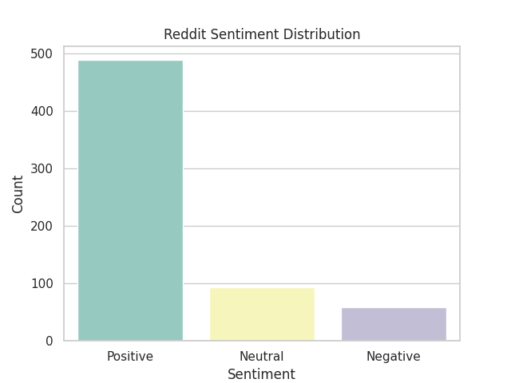
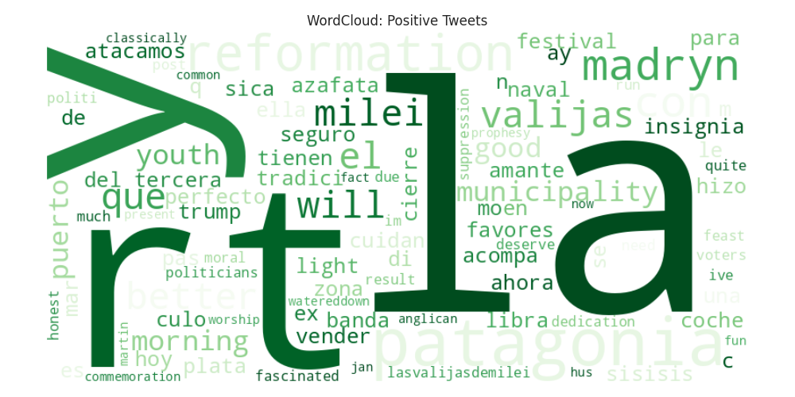
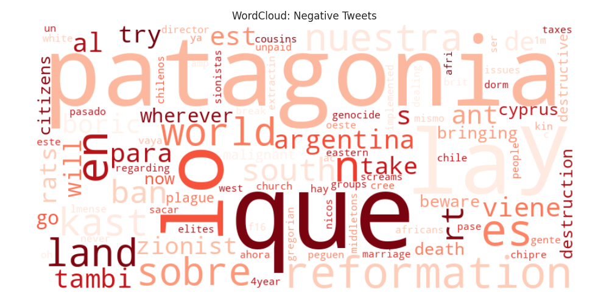
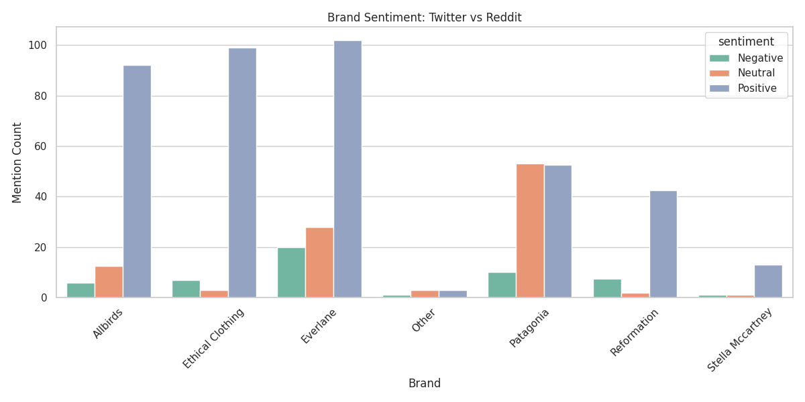

 <p align="center">
  
</p>

<h1 align="center">💜 Fashion Brand Sentiment Analyzer</h1>

<p align="center">
  
  
  
  
</p>

<p align="center">
  <strong>Decoding consumer opinions on sustainable fashion through cross-platform sentiment analysis.</strong>
</p>

<p align="center">
  <a href="https://github.com/abihaha7/fashion-sentiment-analyzer">Explore Repository</a>
  ·
  <a href="https://github.com/abihaha7">GitHub Profile</a>
  ·
  <a href="https://abiha-portfolio-snowy.vercel.app/">Portfolio</a>
</p>

---

## ✦ Overview

How do consumers really feel about sustainable fashion brands?

**Fashion Brand Sentiment Analyzer** is an NLP and data analysis project that explores public discussions about sustainable fashion brands using text collected from Twitter/X and Reddit.

The project combines text preprocessing, lexicon-based sentiment analysis, exploratory data analysis, and visualization to investigate how opinions are expressed across social platforms and brands.

By transforming unstructured text into interpretable sentiment categories and visual summaries, this project demonstrates how natural language processing can support consumer research and sustainability-focused market analysis.

### Project objectives

- Explore public discussions surrounding sustainable fashion.
- Clean and prepare social media text for analysis.
- Classify text into positive, negative, and neutral sentiment categories.
- Visualize sentiment distributions and frequently occurring terms.
- Compare sentiment patterns across selected brands and platforms.
- Practice an end-to-end data science workflow, from data preparation to communicating analytical findings.

## ⟡ Key Features

| Feature | Description |
|---|---|
| Cross-platform analysis | Explore text from Twitter/X and Reddit datasets. |
| Text preprocessing | Clean text using regular expressions and string operations. |
| Sentiment analysis | Apply VADER to estimate sentiment polarity. |
| Exploratory data analysis | Examine sentiment distributions and patterns in the collected data. |
| Word cloud visualization | Highlight prominent terms in positive and negative text subsets. |
| Brand comparison | Compare sentiment patterns across five sustainable fashion brands. |
| Visual reporting | Present results through charts and graphical summaries. |

## ◈ Sustainable Fashion Brands

The analysis focuses on five brands associated with sustainable fashion, responsible production, or alternative materials.

| Brand | Area of interest |
|---|---|
| Patagonia | Outdoor apparel and environmental responsibility |
| Reformation | Fashion and sustainable design |
| Everlane | Apparel and responsible production |
| Allbirds | Footwear and material sustainability |
| Stella McCartney | Luxury fashion and sustainability |

*The inclusion of a brand indicates that it is part of the project's analysis, not that the project independently verifies its sustainability claims.*

## ⌘ Technology Stack

<p>
  
  
  
  
  
  
  
  
</p>

| Component | Tools |
|---|---|
| Programming language | Python |
| Data manipulation | Pandas, NumPy |
| Data collection | Tweepy, PRAW |
| Text processing | Python string operations, regular expressions |
| Sentiment analysis | VADER Sentiment |
| Visualization | Matplotlib, Seaborn, WordCloud |
| Development environment | Google Colab, Jupyter Notebook |

## 📊 Visual Explorations

The following visualizations provide a graphical view of the project's sentiment analysis. They are intended to help explore patterns in the available datasets, rather than establish definitive public opinion.

### 01. Twitter/X Sentiment Distribution

Explore the distribution of sentiment categories in the collected Twitter/X dataset.

> If the corresponding Twitter/X chart is not present in the repository, add it before enabling this image.

<!-- Replace the filename below with the exact name of your Twitter/X chart if available. -->
<!--  -->

### 02. Reddit Sentiment Distribution

Examine how the analyzed Reddit text is distributed across sentiment categories.

<p align="center">
  
</p>

### 03. Positive and Negative Language

Word clouds provide a visual overview of prominent terms in the positive and negative text subsets.

<table>
  <tr>
    <th align="center">Positive Sentiment</th>
    <th align="center">Negative Sentiment</th>
  </tr>
  <tr>
    <td align="center">
      
    </td>
    <td align="center">
      
    </td>
  </tr>
</table>

### 04. Brand Sentiment Comparison

Compare the sentiment patterns represented in the project's brand comparison chart.

<p align="center">
  
</p>

*Visualization availability depends on the files committed to the repository. Image filenames and paths must match exactly, including capitalization.*

## 🧠 Methodology

The project follows a practical text analytics workflow.

1. **Data collection:** Obtain relevant public text from supported social platforms using the project's data collection workflow.
2. **Text preprocessing:** Clean text using string operations and regular expressions to prepare it for analysis.
3. **Sentiment scoring:** Apply VADER to calculate sentiment scores and assign sentiment categories according to the thresholds used in the analysis.
4. **Exploratory data analysis:** Inspect sentiment distributions and examine patterns across datasets.
5. **Brand-level analysis:** Compare the sentiment patterns associated with the selected brands.
6. **Visualization:** Present the analysis using distribution charts, word clouds, and brand comparisons.
7. **Interpretation:** Review the results in the context of the data collected, the sentiment method used, and the limitations of automated text analysis.

### How VADER fits into the project

VADER (Valence Aware Dictionary and sEntiment Reasoner) is a lexicon- and rule-based sentiment analysis tool designed to estimate sentiment in text.

It provides sentiment scores that can be used to categorize text according to chosen thresholds. This makes it useful for an accessible NLP project without requiring the training of a custom deep learning model.

**Important interpretation note:** VADER's output is an estimate, not a verified statement of a person's actual feelings. Sarcasm, context, slang, mixed opinions, and fashion-specific language can affect sentiment classification.

## 📁 Repository Structure

The following structure represents the files and folders documented for this project. The actual repository may differ depending on which notebooks, datasets, and visualizations have been uploaded.

```text
fashion-sentiment-analyzer/
├── assets/
│   └── project-banner.png
├── FashionFeelingsBot.ipynb
├── brand_comparison.png
├── cleaned_fashion_tweets.csv
├── fashion_sentiment_labeled.csv
├── reddit_fashion_sentiment.csv
├── reddit_sentiment_distribution.png
├── sustainable_fashion_tweets.csv
├── wordcloud_negative.png
├── wordcloud_positive.png
├── requirements.txt
├── .gitignore
└── README.md
```

*This tree reflects the files visible in the local directory listing shared during project setup. Update it if you add or reorganize files.*

## 🚀 Getting Started

You can explore the available notebook and datasets locally or in Google Colab.

### Prerequisites

- Python 3.10 or a compatible Python version for the installed dependencies.
- Git.
- Jupyter Notebook or Google Colab.
- Platform API credentials if you intend to rerun data collection.

### 1. Clone the repository

```bash
git clone https://github.com/abihaha7/fashion-sentiment-analyzer.git
cd fashion-sentiment-analyzer
```

### 2. Create a virtual environment

```bash
python -m venv .venv
```

Activate it on Windows:

```powershell
.venv\Scripts\Activate.ps1
```

If PowerShell blocks activation, you can use Command Prompt instead:

```cmd
.venv\Scripts\activate.bat
```

### 3. Install dependencies

If a `requirements.txt` file is available and contains the project's dependencies, run:

```bash
python -m pip install -r requirements.txt
```

The project uses libraries including Pandas, NumPy, VADER Sentiment, Matplotlib, Seaborn, and WordCloud. Data collection notebooks may additionally require Tweepy and PRAW.

If a dependency is missing, install the corresponding package in your active environment.

### 4. Launch Jupyter Notebook

```bash
jupyter notebook
```

Open `FashionFeelingsBot.ipynb` and run the notebook cells in order, checking that any required input files and dependencies are available.

Alternatively, upload the notebook and required datasets to Google Colab.

## 🔐 Data Collection and API Configuration

Re-running data collection may require credentials and appropriate access to the relevant platform APIs.

- Use the official API access methods available to your account.
- Store credentials in environment variables or a local environment file excluded from version control.
- Respect platform terms, rate limits, privacy requirements, and applicable data-use policies.
- Do not commit API keys, access tokens, passwords, or private credentials.

The existing datasets can be used to explore the analysis without repeating the data collection process, provided the necessary files are included in the repository.

## ⚖️ Limitations

A responsible interpretation of sentiment analysis requires acknowledging its limitations.

- **Context sensitivity:** Short social media posts may not provide enough context to determine the intended meaning.
- **Sarcasm and irony:** A lexicon-based model can misinterpret sarcastic or ironic expressions.
- **Domain-specific language:** Fashion terminology and sustainability-related expressions may not be fully captured by a general-purpose sentiment lexicon.
- **Data coverage:** Collected posts represent the available sample, not necessarily all consumers or the entire public.
- **Platform differences:** Twitter/X and Reddit differ in post length, user communities, and discussion styles.
- **Model evaluation:** Sentiment classifications should not be treated as ground truth without comparison against manually labelled examples.

The results are best understood as exploratory insights into the collected text, rather than a definitive measurement of brand reputation or consumer attitudes.

## 🔭 Future Directions

Potential extensions include:

- **Transformer-based sentiment analysis:** Experiment with models such as BERT and compare their performance with VADER.
- **Sarcasm-aware NLP:** Explore approaches that better account for context, irony, and nuanced language.
- **Model evaluation:** Create a manually labelled evaluation set and measure precision, recall, and F1-score.
- **Interactive dashboard:** Build a Streamlit dashboard for exploring sentiment by brand, platform, and category.
- **Temporal sentiment analysis:** Examine how sentiment patterns change over time when timestamped data is available.
- **Expanded data sources:** Explore additional platforms where data access and platform policies permit.
- **Explainability:** Investigate why individual texts receive particular sentiment classifications.

## 👩‍💻 Author

**Abiha Abdul Hameed**  
Software Engineering Graduate | AI/ML & Data Science

<p>
  <a href="https://github.com/abihaha7">
    
  </a>
  <a href="https://abiha-portfolio-snowy.vercel.app/">
    
  </a>
</p>

---

<p align="center">
  <em>Exploring the intersection of language, consumer behaviour, and sustainable fashion.</em>
</p>