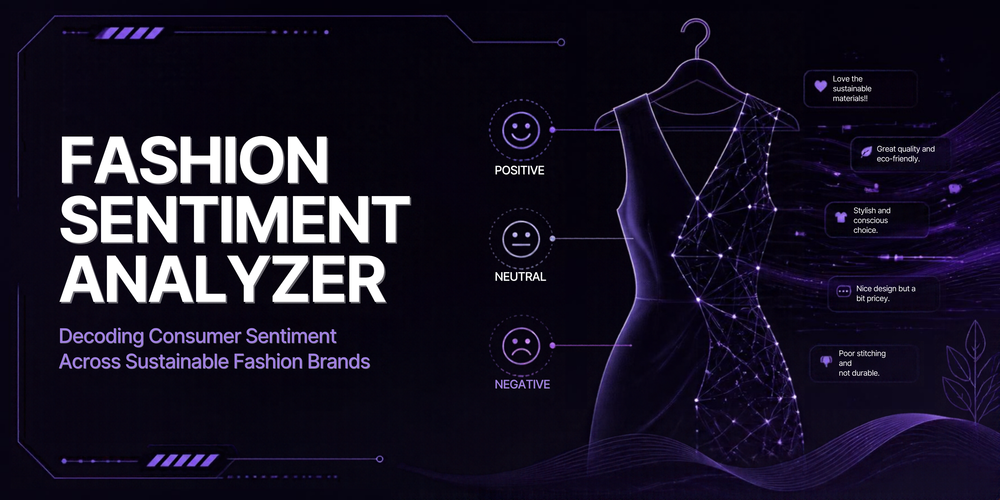

<p align="center">
  
</p>
# 💜 Fashion Brand Sentiment Analyzer

<p align="center">
  
  
  
</p>

<p align="center">
  <b>Decoding consumer opinions on sustainable fashion through cross-platform sentiment analysis.</b>
</p>

<p align="center">
  <a href="https://github.com/abihaha7/fashion-sentiment-analyzer">
    
  </a>
</p>

---

## ✦ Overview

How do consumers really feel about sustainable fashion brands?

The **Fashion Brand Sentiment Analyzer** is an NLP project that explores public opinions about sustainable fashion brands using text collected from Twitter/X and Reddit.

By combining text preprocessing, VADER sentiment analysis, and data visualization, the project examines positive, negative, and neutral sentiment across platforms and brands.

The goal is to turn unstructured social media discussions into interpretable insights for fashion researchers, brand analysts, and sustainability-focused teams.

## ⟡ Project Highlights

- **Cross-platform analysis:** Explore discussions from Twitter/X and Reddit.
- **Text preprocessing:** Clean and prepare text using regular expressions and string operations.
- **Sentiment classification:** Apply VADER to estimate the sentiment expressed in text.
- **Visual storytelling:** Use sentiment distributions, word clouds, and comparison charts.
- **Brand comparison:** Examine differences in sentiment across five sustainable fashion brands.

## ◈ Brands Under Analysis

| Brand | Focus |
|---|---|
| Patagonia | Outdoor apparel and sustainability |
| Reformation | Fashion and sustainable design |
| Everlane | Apparel and responsible production |
| Allbirds | Footwear and material sustainability |
| Stella McCartney | Luxury fashion and sustainability |

## ⌘ Technology Stack

<p>
  
  
  
  
  
  
  
  
</p>

| Component | Tools |
|---|---|
| Data collection | Tweepy, PRAW |
| Data processing | Pandas, NumPy, regular expressions |
| NLP and sentiment | VADER Sentiment |
| Visualization | Matplotlib, Seaborn, WordCloud |
| Development | Google Colab, Jupyter Notebook |

## 📊 Visual Explorations

The following visualizations illustrate how the project explores sentiment patterns across platforms and brands.

### 01 — Twitter/X Sentiment Distribution

Explore the distribution of sentiment labels in the collected Twitter/X dataset.


### 02 — Reddit Sentiment Distribution

Compare the sentiment distribution observed in Reddit discussions.


### 03 — Positive and Negative Language

Word clouds provide a visual overview of prominent terms in the positive and negative text subsets.

| Positive sentiment | Negative sentiment |
|---|---|
|  |  |

### 04 — Cross-Platform Brand Comparison

Compare the sentiment patterns observed for the selected brands across Twitter/X and Reddit.


## 🧠 Methodology

The project follows a practical NLP workflow:

1. **Data collection:** Gather relevant public posts and discussions from supported platforms.
2. **Preprocessing:** Clean the text and prepare it for sentiment analysis.
3. **Sentiment scoring:** Use VADER to estimate sentiment polarity and classify text according to the project's chosen thresholds.
4. **Exploratory analysis:** Examine sentiment distributions by platform and brand.
5. **Visualization:** Present patterns through charts, word clouds, and cross-platform comparisons.

**Interpretation note:** VADER is a lexicon- and rule-based sentiment tool. Its labels are estimates of expressed sentiment, not ground-truth opinions. Sarcasm, context, and domain-specific language can affect its performance.

## 📁 Repository Structure

```text
fashion-sentiment-analyzer/
├── data/
│   ├── fashion_sentiment_labeled.csv
│   └── reddit_fashion_sentiment.csv
├── notebooks/
│   ├── 01_twitter_data_collection.ipynb
│   ├── 02_twitter_sentiment_analysis.ipynb
│   ├── 03_reddit_data_collection.ipynb
│   └── 04_combined_visualization.ipynb
├── visuals/
│   ├── twitter_sentiment_distribution.png
│   ├── reddit_sentiment_distribution.png
│   ├── wordcloud_positive.png
│   ├── wordcloud_negative.png
│   └── brand_comparison.png
├── requirements.txt
├── .gitignore
└── README.md
```

*The structure above reflects the documented project layout. Adjust it if your actual repository differs.*

## 🚀 Getting Started

### Prerequisites

- Python 3.10 or a compatible Python version for your dependencies
- Git
- Jupyter Notebook or Google Colab
- Platform API credentials if you want to run the data collection notebooks

### Installation

Clone the repository:

```bash
git clone https://github.com/abihaha7/fashion-sentiment-analyzer.git
cd fashion-sentiment-analyzer
```

Create a virtual environment:

```bash
python -m venv .venv
```

Activate it on Windows:

```powershell
.venv\Scripts\Activate.ps1
```

Install the dependencies:

```bash
python -m pip install -r requirements.txt
```

Launch Jupyter:

```bash
jupyter notebook
```

Alternatively, open the notebooks in Google Colab.

### API Configuration

Data collection requires valid credentials and access permitted by the relevant platform APIs. Configure credentials through environment variables or a local environment file that is excluded from version control.

**Never commit API keys, tokens, passwords, or private credentials.** Existing CSV files and visualizations may be used to explore the analysis without repeating data collection, provided those files are available.

## 🔭 Future Directions

- Explore transformer-based sentiment models such as BERT.
- Develop an interactive Streamlit dashboard.
- Track sentiment changes over time.
- Evaluate model performance against manually labelled examples.
- Investigate sarcasm, contextual language, and domain-specific expressions.
- Expand cross-platform analysis where permitted by platform policies.

## 👩‍💻 Author

**Abiha Abdul Hameed**  
Software Engineering Graduate | AI/ML & Data Science

[GitHub](https://github.com/abihaha7) · [Portfolio](https://abiha-portfolio-snowy.vercel.app/)

---

<p align="center">
  <i>Exploring the intersection of language, consumer behaviour, and sustainable fashion.</i>
</p>
